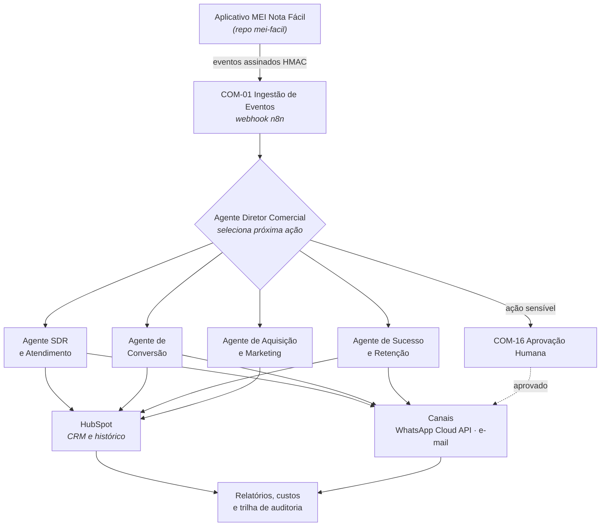

# MEI Nota Fácil — Sistema Comercial Autônomo de IA

Sistema que administra a operação comercial do SaaS **MEI Nota Fácil**: captura de leads,
qualificação, atendimento, acompanhamento do teste gratuito de 31 dias, conversão,
retenção, reativação e inteligência comercial — com intervenção humana apenas onde ela é
obrigatória.

> **Repositório privado.** Não contém credenciais, dados de clientes, conversas reais nem
> exportações de produção. Ver [SECURITY.md](SECURITY.md).

---

## 1. Finalidade

Este repositório é a **fonte de versionamento** do sistema comercial:

| Guarda aqui | Não guarda aqui |
|---|---|
| Prompts, políticas comerciais, agentes | Credenciais, tokens, chaves |
| Workflows do n8n (JSON sanitizado) | Dados de clientes, conversas, backups |
| Contratos de integração e schemas de eventos | Logs e execuções de produção |
| Documentação, ADRs, testes | O banco operacional do SaaS |

O **n8n** é o ambiente de execução. O **HubSpot** é o CRM. O GitHub não executa
automação nem armazena dado pessoal.

---

## 2. Relação com o SaaS principal

O código do produto vive em `fabriciopazadv/mei-facil` (Next.js 16 + Prisma + PostgreSQL,
deploy na Vercel). A decisão de manter os dois repositórios separados está registrada em
[docs/commercial-ai/02-decisao-repositorio.md](docs/commercial-ai/02-decisao-repositorio.md)
e [ADR-001](docs/commercial-ai/adr/ADR-001-repositorio-separado.md).

A comunicação entre os dois é feita **apenas** por eventos assinados via HTTP. Este sistema
não tem acesso ao banco de produção do SaaS. O contrato está em
[docs/commercial-ai/integration-contract.md](docs/commercial-ai/integration-contract.md).

---

## 3. Arquitetura



Detalhamento em [docs/commercial-ai/02-arquitetura.md](docs/commercial-ai/02-arquitetura.md).

### Princípio de decisão

1. **Não usar IA** quando regra, filtro, consulta ou template resolvem.
2. **Modelo econômico** para classificar, extrair, resumir e detectar intenção.
3. **Modelo avançado** só para objeção complexa, conflito de informação e análise estratégica.

---

## 4. Tecnologias

| Camada | Escolha | Por quê |
|---|---|---|
| Orquestração | n8n (já contratado) | Agenda, webhooks, filas, human-in-the-loop |
| CRM | HubSpot (já contratado) | Contatos, negócios, atividades, pipeline |
| Mensageria | WhatsApp Business Cloud API (Meta, oficial) | Sem intermediário/BSP pago — ver [ADR-004](docs/commercial-ai/adr/ADR-004-whatsapp-cloud-api.md) |
| IA | Abstração de provedor (Gemini / Anthropic) | Mesma abstração já usada no SaaS |
| Código auxiliar | TypeScript + Zod + Vitest | Alinhado ao stack do `mei-facil` |

---

## 5. Pré-requisitos

- Node.js 20+
- Acesso ao n8n (URL + API key) — **somente para os scripts de export/import**
- Private App do HubSpot com os escopos de [05-hubspot.md](docs/commercial-ai/05-hubspot.md)
- Número comercial próprio registrado na WhatsApp Cloud API

---

## 6. Configuração local

```bash
git clone git@github.com:fabriciopazadv/mei-nota-facil-commercial-ai.git
cd mei-nota-facil-commercial-ai
npm install
cp .env.example .env      # preencha localmente; o .env nunca é versionado
npm run check             # typecheck + testes + validações + varredura de segredos
```

Nenhum comando deste repositório envia mensagem, altera o HubSpot ou toca em produção.
Os scripts que falam com o n8n exigem `--confirm` explícito e recusam o ambiente
`production` por padrão.

---

## 7. Variáveis de ambiente

Todas estão documentadas em [`.env.example`](.env.example). As críticas:

| Variável | Função |
|---|---|
| `WEBHOOK_SIGNING_SECRET` | HMAC dos eventos vindos do SaaS |
| `WHATSAPP_APP_SECRET` | Validação do `X-Hub-Signature-256` da Meta |
| `AI_MAX_COST_DAILY` / `AI_MAX_COST_MONTHLY` | Teto de gasto com IA |
| `COMMERCIAL_AI_KILL_SWITCH` | Congela todo envio automatizado sem deploy |

---

## 8. Testes

```bash
npm test                  # Vitest
npm run validate:prompts  # metadados obrigatórios de todo prompt
npm run validate:config   # políticas comerciais contra os schemas Zod
npm run security:check    # varredura de segredos e dados pessoais
```

Os testes usam **exclusivamente dados fictícios** (`tests/fixtures/`). Telefone, e-mail e
nome reais de clientes são proibidos — inclusive mascarados. Ver
[docs/commercial-ai/09-seguranca.md](docs/commercial-ai/09-seguranca.md).

---

## 9. Exportação e importação do n8n

O GitHub versiona; o n8n executa.

```bash
npm run n8n:export -- --env=staging          # baixa e sanitiza para automation/n8n/workflows/
npm run n8n:import -- --env=staging --confirm # importa; production exige aprovação humana
```

A sanitização remove credenciais, tokens, URLs secretas, headers sensíveis e dados de
execução **antes** do commit. Um workflow que não passa no `validate:workflows` não entra
no repositório. Detalhes em [docs/commercial-ai/06-n8n.md](docs/commercial-ai/06-n8n.md).

---

## 10. Integrações

- **HubSpot** — propriedades, pipeline e limites do plano atual: [05-hubspot.md](docs/commercial-ai/05-hubspot.md)
- **WhatsApp** — janela de atendimento, categorias de template e consentimento: [07-whatsapp.md](docs/commercial-ai/07-whatsapp.md)
- **E-mail** — camada abstrata e escolha de provedor: [08-email.md](docs/commercial-ai/08-email.md)
- **Eventos do SaaS** — catálogo e schema: [04-eventos.md](docs/commercial-ai/04-eventos.md)

---

## 11. Segurança e LGPD

- Política de segurança: [SECURITY.md](SECURITY.md)
- Controles técnicos: [09-seguranca.md](docs/commercial-ai/09-seguranca.md)
- Privacidade: [10-lgpd.md](docs/commercial-ai/10-lgpd.md) e os quatro documentos
  `lgpd-*.md` (mapa de dados, base legal, retenção, resposta a incidentes)

Os documentos de LGPD **não são parecer jurídico**. Os pontos que exigem validação de
advogado estão marcados com `⚖️ VALIDAÇÃO JURÍDICA NECESSÁRIA`.

---

## 12. Contribuição

Ver [CONTRIBUTING.md](CONTRIBUTING.md): estratégia de branches, padrão de commits
(`tipo(escopo): descrição`) e checklist de pull request.

A branch `main` recebe apenas versões estáveis, sempre por pull request revisado.

---

## 13. Ambientes

| Ambiente | Uso | Dados |
|---|---|---|
| `development` | Desenvolvimento e testes locais | Sintéticos |
| `staging` | Integração, homologação de workflows | Sintéticos |
| `production` | Operação real | Reais — exige aprovação manual |

Configuração por ambiente em `config/environments/`.

---

## 14. Deploy

Ver [12-deploy.md](docs/commercial-ai/12-deploy.md). Resumo: nenhuma alteração chega a
produção sem backup, validação em staging, aprovação humana e plano de reversão escrito.

---

## 15. Solução de problemas

Runbook operacional em [13-operacao.md](docs/commercial-ai/13-operacao.md) e resposta a
incidentes em [14-incidentes.md](docs/commercial-ai/14-incidentes.md).

Para parar tudo imediatamente: `COMMERCIAL_AI_KILL_SWITCH=true` no n8n e no ambiente de
execução. Nenhuma mensagem sai com o interruptor ativo.

---

## 16. Responsáveis

| Papel | Responsável |
|---|---|
| Proprietário do produto e aprovador comercial | Fabrício Paz |
| Aprovação de custos, descontos e campanhas | Fabrício Paz |
| Validação jurídica (LGPD, fiscal) | ⚠️ a definir |
| Construção e manutenção técnica | Agente construtor (Claude) sob revisão humana |

---

## 17. Estado atual

**Fase 0 — Auditoria: concluída.** Ver
[01-auditoria-inicial.md](docs/commercial-ai/01-auditoria-inicial.md) e o roadmap em
[15-roadmap.md](docs/commercial-ai/15-roadmap.md).

Nenhuma integração está ativa. Nenhuma mensagem é enviada. Nenhum custo foi gerado.
