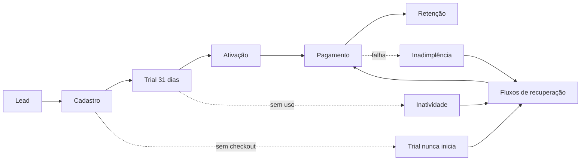

# 00 — Visão Geral

## O que é

O Sistema Comercial Autônomo é a operação de vendas do MEI Nota Fácil executada por
software: atrai, captura, qualifica, atende, acompanha o teste gratuito, converte, retém,
reativa e relata — chamando uma pessoa apenas quando a decisão é humana por natureza.

## O que ele não é

- Não é um chatbot. É uma máquina de estados comercial que usa IA em pontos específicos.
- Não é autônomo em dinheiro. Preço, desconto, campanha paga e reembolso exigem aprovação.
- Não é o produto. Não emite nota, não gera recibo, não toca no banco do SaaS.

## Problema que resolve

Hoje o MEI Nota Fácil tem produto e não tem funil. Ninguém sabe quantas pessoas se
cadastraram e não iniciaram o teste, quantas abandonaram o checkout, quantas pararam de
usar antes de virar cliente. Sem medir, não há o que otimizar.

## Princípios

1. **Determinismo primeiro.** Se regra, filtro, consulta ou template resolvem, não se usa
   IA. IA custa dinheiro e introduz variância.
2. **O usuário fala primeiro.** A janela de 24 horas do WhatsApp é o recurso mais barato
   que existe. A arquitetura persegue conversas iniciadas pelo cliente.
3. **Uma mensagem que resolve vale mais que três que informam.** Menos mensagens é ao mesmo
   tempo mais barato e melhor atendimento.
4. **Política fora do prompt.** Desconto, limite, score e frequência vivem em `config/`,
   versionados e revisados. A IA lê; não altera.
5. **Silêncio é resposta.** Opt-out, conversão, cancelamento e resposta humana param a
   sequência imediatamente.
6. **Registrar tudo, decidir pouco sozinho.** Toda decisão automatizada relevante fica na
   trilha de auditoria com a regra que a produziu.

## Componentes

| Componente | Papel | Fonte da verdade de |
|---|---|---|
| Aplicativo `mei-facil` | Emite eventos comportamentais | Dados operacionais do produto |
| n8n | Orquestra, agenda, integra, controla aprovação | Execução |
| HubSpot | Registro comercial | Relacionamento: contatos, negócios, atividades |
| Agentes de IA | Compreendem linguagem, classificam, personalizam | Nada — só propõem |
| WhatsApp / e-mail | Canais de saída | — |
| `config/` | Políticas comerciais | Regras de negócio |

## Fluxo de valor

O gargalo conhecido está em `X1`: no SaaS atual, o trial de 31 dias só começa quando a
pessoa vincula pagamento no checkout. Ver `01-auditoria-inicial.md` §2.4.

## Documentos

| Arquivo | Conteúdo |
|---|---|
| `01-auditoria-inicial.md` | Diagnóstico da Fase 0 |
| `02-arquitetura.md` | Arquitetura técnica |
| `02-decisao-repositorio.md` | Repositório separado vs monorepositório |
| `03-agentes.md` | Os cinco agentes e seus limites |
| `04-eventos.md` | Catálogo e contrato dos eventos |
| `05-hubspot.md` | Propriedades, pipeline e limites do plano |
| `06-n8n.md` | Workflows, padrões, export/import |
| `07-whatsapp.md` | Cloud API, janela, templates, custos |
| `08-email.md` | Camada de e-mail e escolha de provedor |
| `09-seguranca.md` | Controles técnicos |
| `10-lgpd.md` + `lgpd-*.md` | Privacidade |
| `11-custos.md` | Mapa e controle de custos |
| `12-deploy.md` | Implantação e rollback |
| `13-operacao.md` | Runbook |
| `14-incidentes.md` | Resposta a incidentes |
| `15-roadmap.md` | Fases 0 a 7 |
| `integration-contract.md` | Contrato SaaS ↔ sistema comercial |
| `adr/` | Decisões arquiteturais |
