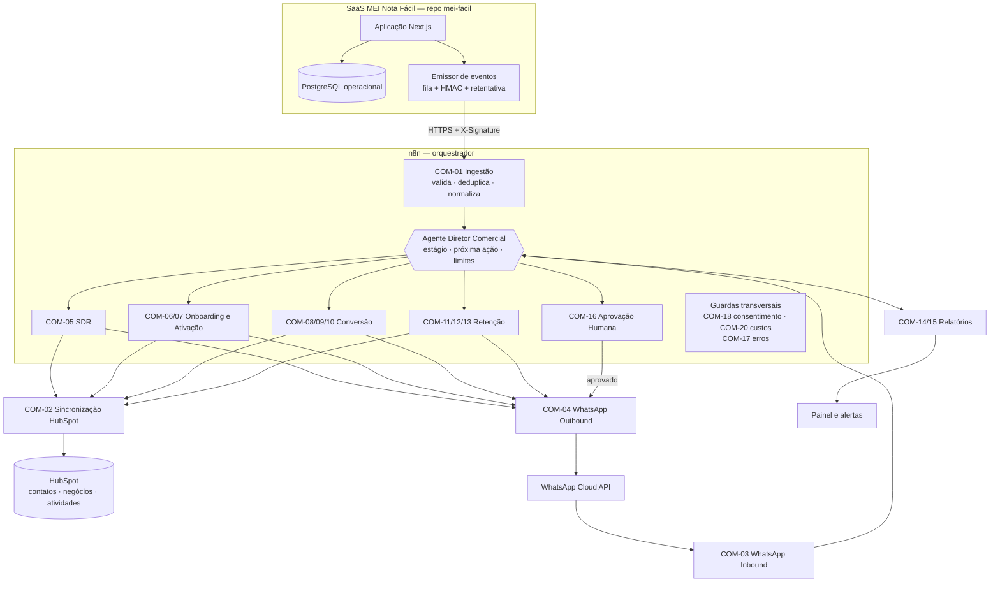
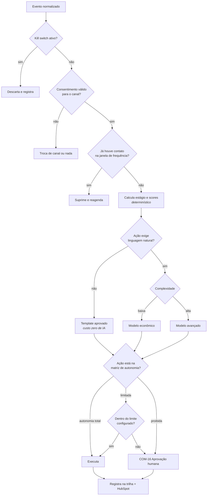
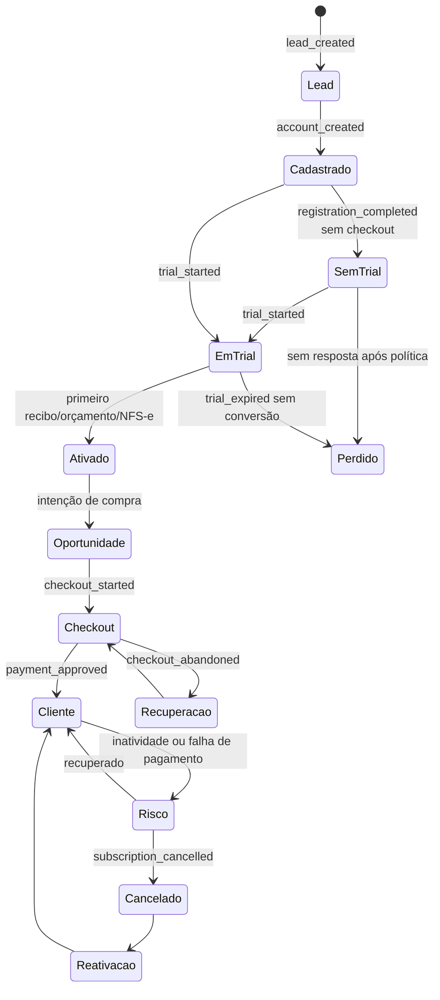
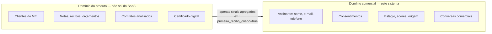

# 02 — Arquitetura

## 1. Visão geral

Orquestração **centralizada**. Não existem agentes autônomos conversando entre si sem
controle: existe um Diretor Comercial que recebe eventos, decide e delega ações
delimitadas a especialistas.

## 2. Responsabilidades

| Componente | Faz | Não faz |
|---|---|---|
| **Aplicativo** | Emite eventos comportamentais assinados | Não decide nada comercial |
| **Banco do SaaS** | Fonte primária dos dados do produto | Não é acessado por este sistema |
| **n8n** | Orquestra, agenda, integra, controla aprovação e custo | Não guarda regra de negócio no nó |
| **HubSpot** | Registro comercial e histórico | Não automatiza (plano atual não tem Workflows) |
| **Agentes de IA** | Interpretam, classificam, redigem, recomendam | Não executam ação sensível nem alteram política |
| **`config/`** | Guarda as regras | — |

## 3. Por que o n8n é o motor

A auditoria confirmou que o HubSpot do portal 51640620 **não tem Workflows, objeto Leads
nem Campaigns** (`01-auditoria-inicial.md` §4). Concentrar automação no n8n não é
preferência: é a única opção que não exige upgrade. Ver `ADR-002`.

Vantagem colateral: as regras ficam versionadas neste repositório, auditáveis por diff, e
não presas à interface de um CRM.

## 4. Camada de decisão

O Diretor Comercial **não é um prompt gigante**. É uma sequência determinística com um
ponto de IA:

Os passos S1 a S4 são código, não IA. A IA entra em S5 apenas quando a resposta precisa de
linguagem natural. **A maioria dos eventos nunca chega em S5.**

## 5. Estados do contato

O estado **`SemTrial`** é específico deste produto e é o mais importante a instrumentar:
no SaaS atual a pessoa se cadastra, mas o trial de 31 dias só começa no checkout.

## 6. Onde a IA entra — e onde não entra

| Tarefa | Solução | Custo |
|---|---|---|
| Detectar `trial_day_26` | Agendamento | Zero |
| Decidir se contata | Regra + `config/commercial-rules/contact-frequency.json` | Zero |
| Calcular scores | Aritmética sobre `config/commercial-rules/lead-scoring.json` | Zero |
| Escolher template para estado conhecido | Tabela de correspondência | Zero |
| Classificar intenção de mensagem livre | Modelo econômico | Baixo |
| Extrair dados de uma frase | Modelo econômico | Baixo |
| Resumir conversa longa | Modelo econômico | Baixo |
| Responder objeção complexa | Modelo avançado | Alto |
| Analisar conflito de informação | Modelo avançado | Alto |
| Elaborar campanha | Modelo avançado + aprovação humana | Alto |

Regra prática: **se a pergunta tem resposta única e conhecida, não é trabalho de IA.**

## 7. Isolamento de dados

O sistema comercial **nunca** recebe o conteúdo de um documento fiscal, o nome de um cliente
do MEI, o texto de um contrato analisado ou dado de certificado. Recebe apenas o **sinal de
que a ação ocorreu**. Ver `lgpd-mapa-de-dados.md` e `ADR-005`.

## 8. Resiliência

| Falha | Comportamento |
|---|---|
| SaaS não entrega evento | Fila com retentativa exponencial; após o limite, fila de falhas |
| Evento duplicado | Trava por `event_id`; segunda vez é sem efeito |
| HubSpot fora do ar | Enfileira; reprocessa; alerta após limite |
| WhatsApp fora do ar | Enfileira dentro do prazo válido; se a janela expirar, cai para template ou e-mail |
| IA fora do ar ou teto de custo atingido | Fallback determinístico por template; nunca fica mudo |
| n8n fora do ar | Eventos se acumulam na fila do SaaS; reprocessam ao voltar |
| Baixa confiança da IA | Encaminha para humano; não improvisa |

## 9. Convenções

- Dinheiro em **centavos (`Int`)**, como no SaaS.
- Telefone em **E.164** (`+5511900000000`).
- Data/hora em **ISO 8601 UTC**; exibição em `America/Sao_Paulo`.
- Idempotência por `event_id` (UUID v4) gerado na origem.
- Nome de workflow: `COM-NN-Nome-Em-Kebab`.
- Todo log passa pelo redator de dados pessoais.
