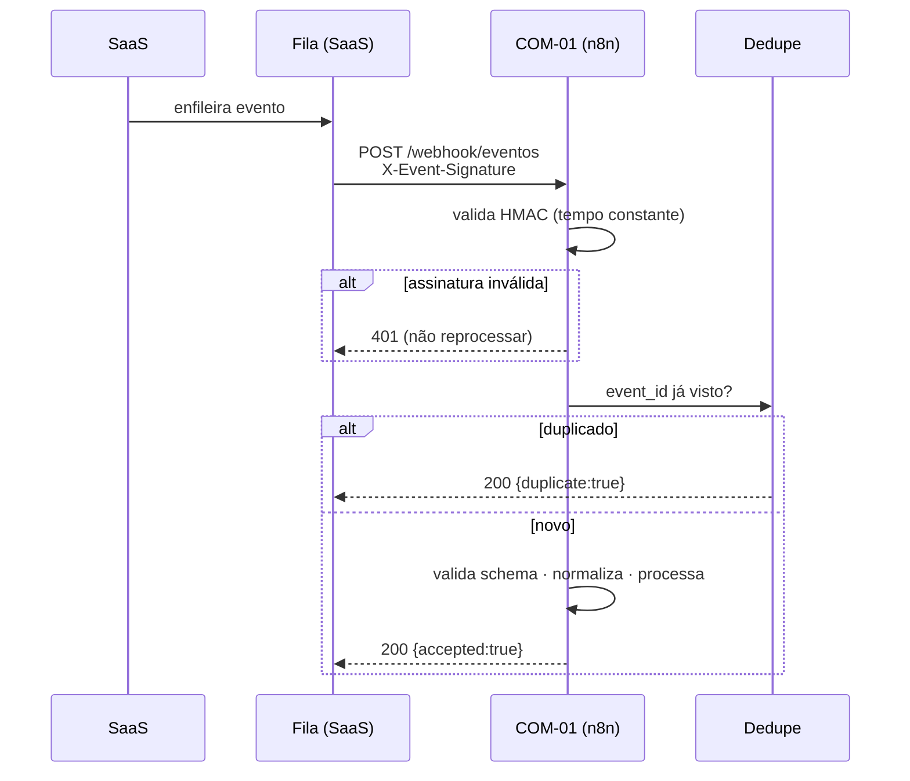

# 04 — Eventos

## 1. Situação

O SaaS **não emite nenhum evento hoje**. Existe `AuditLog` (interno, sem entrega garantida)
e `QuoteEvent` (ciclo do orçamento, interno). Nenhum sai da aplicação.

Construir o emissor de eventos é o **primeiro trabalho da Fase 1**. Sem ele o sistema
comercial não tem entrada.

## 2. Envelope

Todo evento segue o mesmo formato:

```json
{
  "event_id": "550e8400-e29b-41d4-a716-446655440000",
  "event_name": "trial_started",
  "event_version": 1,
  "occurred_at": "2026-07-24T18:30:00.000Z",
  "user_id": "clx1a2b3c4d5e6f7g8h9",
  "tenant_id": "clx0z9y8x7w6v5u4t3s2",
  "contact_id": null,
  "email": "teste@example.com",
  "phone": "+5511900000000",
  "source": "google_ads",
  "campaign": "mei-nfse-julho",
  "plan": "MENSAL",
  "trial_day": 0,
  "metadata": {}
}
```

| Campo | Obrigatório | Regra |
|---|---|---|
| `event_id` | ✅ | UUID v4 gerado na origem. Chave de idempotência |
| `event_name` | ✅ | Do catálogo §3. Desconhecido = rejeitado |
| `event_version` | ✅ | Inteiro. Começa em 1 |
| `occurred_at` | ✅ | ISO 8601 UTC. **Quando aconteceu**, não quando foi enviado |
| `user_id` | ✅¹ | `User.id` do SaaS |
| `tenant_id` | ✅¹ | `Tenant.id` do SaaS |
| `contact_id` | ➖ | Id no HubSpot; nulo até o primeiro upsert |
| `email` | ✅¹ | Minúsculo, sem espaço |
| `phone` | ➖ | **E.164** (`+5511900000000`) ou ausente. Nunca formato local |
| `source` / `campaign` | ➖ | Origem e campanha, quando conhecidas |
| `plan` | ➖ | `TRIAL` \| `MENSAL` \| `SEMESTRAL` |
| `trial_day` | ➖ | Dia do teste (0–31) |
| `metadata` | ➖ | Objeto plano. **Nunca dado do cliente do MEI** |

¹ Obrigatório exceto em `lead_created`, que pode chegar antes de existir conta.

### Proibido no `metadata`

Conteúdo de documento fiscal, nome/CPF/CNPJ de cliente do MEI, texto de contrato analisado,
valores de nota, dados de certificado digital, senha, token. O sistema comercial recebe o
**sinal**, não o **conteúdo**. Ver `lgpd-mapa-de-dados.md`.

## 3. Catálogo (38 eventos)

### Aquisição e cadastro
| Evento | Gatilho | Efeito comercial |
|---|---|---|
| `lead_created` | Formulário, WhatsApp, indicação | Cria contato; entra no pipeline |
| `account_created` | `POST /api/auth/register` | Contato → estágio Cadastro |
| `registration_started` | Início do formulário | Base para abandono |
| `registration_completed` | Cadastro concluído | **Marco crítico** — ver §4 |
| `email_verified` | Verificação de e-mail | Libera e-mail transacional |
| `business_profile_completed` | `MeiProfile` preenchido | +10 ativação |

### Ativação no produto
| Evento | Gatilho | Efeito |
|---|---|---|
| `first_client_created` | 1º `Customer` | +10 ativação |
| `first_budget_created` | 1º `Quote` | +15 ativação e intenção |
| `first_receipt_created` | 1º recibo | +15 — **valor percebido** |
| `first_expense_created` | 1ª despesa | +5 |
| `first_revenue_created` | 1ª receita | +5 |
| `contract_analysis_started` | `/api/ai/contract-review` | Interesse em premium |
| `contract_analysis_completed` | Relatório concluído | +15 |
| `nfse_started` | Tentativa de NFS-e | **+20 — maior sinal de intenção** |
| `nfse_completed` | NFS-e emitida | Ativação plena |
| `premium_feature_viewed` | Tela de função paga | Sinal de interesse |

### Teste gratuito
| Evento | Gatilho |
|---|---|
| `trial_started` | Trial de 31 dias efetivamente iniciado |
| `trial_day_3` · `trial_day_7` · `trial_day_14` · `trial_day_21` · `trial_day_26` · `trial_day_29` | Agendados a partir de `trial_started` |
| `trial_expired` | `trialEndsAt` vencido sem conversão |

### Conversão e pagamento
| Evento | Gatilho | Efeito |
|---|---|---|
| `checkout_started` | `/api/billing/checkout` | **+30 intenção** |
| `checkout_abandoned` | Sem conclusão no prazo da política | Dispara COM-09 |
| `payment_pending` | Cobrança aguardando | Acompanhar |
| `payment_approved` | `PAYMENT_CONFIRMED`/`RECEIVED` | **Converte + para todas as sequências** |
| `payment_failed` | `PAYMENT_OVERDUE` | +10 intenção, +20 risco |
| `subscription_activated` | Assinatura `ATIVA` | Cliente |

### Retenção e saída
| Evento | Gatilho | Efeito |
|---|---|---|
| `user_inactive_3_days` | Sem atividade há 3 dias | −5 ativação |
| `user_inactive_7_days` | 7 dias | **−15** |
| `user_inactive_15_days` | 15 dias | **−30** |
| `cancellation_requested` | Pedido de cancelamento | **+50 risco** |
| `subscription_cancelled` | Assinatura `CANCELADA` | Encerra sequências; entra em reativação |
| `support_requested` | `/api/support` | Cria ticket |
| `nps_received` | Resposta de NPS | Alimenta retenção |
| `referral_created` | Indicação | Novo lead com origem |

## 4. O evento mais importante deste produto

No SaaS atual, `registration_completed` **não** implica `trial_started`: o trial de 31 dias
só começa quando a pessoa vincula pagamento no checkout
(`src/app/api/auth/register/route.ts` cria a assinatura com `trialEndsAt = agora`).

Existe portanto um estado invisível: **cadastrado, sem trial, sem acesso premium**.

Regra do Diretor Comercial:

```
se registration_completed E não houve trial_started em 30 minutos
  → estado "SemTrial"
  → COM-06 assume com fluxo de recuperação próprio
  → mensagem explica que faltou vincular o pagamento para liberar os 31 dias grátis
```

Provavelmente é o maior vazamento do funil. É a primeira coisa a medir.

## 5. Entrega



### Assinatura

```
X-Event-Signature: sha256=<hex>
X-Event-Timestamp: <epoch em segundos>

assinatura = HMAC_SHA256(WEBHOOK_SIGNING_SECRET, timestamp + "." + corpo_bruto)
```

- Comparação em **tempo constante** (`timingSafeEqual`) — mesmo padrão já usado no webhook
  do Asaas no SaaS.
- Timestamp fora de ±5 minutos é rejeitado (proteção contra repetição).
- Corpo **bruto**, antes de qualquer parsing.

### Códigos de resposta

| Código | Significado | Origem deve reenviar? |
|---|---|---|
| `200` | Aceito ou duplicado | Não |
| `400` | Schema inválido | Não (defeito) |
| `401` | Assinatura inválida ou expirada | Não |
| `422` | Evento desconhecido | Não |
| `429` | Limite de taxa | Sim, com recuo |
| `5xx` | Falha temporária | Sim, com recuo |

### Retentativa

Backoff exponencial: 1s, 2s, 4s, 8s, 16s, 32s, 64s (7 tentativas, ~2 min). Depois, fila de
falhas com alerta. Nenhum evento se perde silenciosamente.

## 6. Idempotência

`event_id` é a chave. Já visto → resposta `200 {duplicate:true}`, sem efeito.

Janela de deduplicação: **7 dias** (cobre qualquer retentativa realista).

Implementação: `src/events/idempotency.ts`; contrato em `tests/unit/idempotency.test.ts`.

## 7. Correlação

- `user_id` correlaciona a jornada inteira de um assinante.
- `event_id` identifica a ocorrência única.
- `metadata.correlation_id` agrupa eventos de um mesmo fluxo (ex.: checkout → pagamento).

## 8. Versionamento

`event_version` começa em 1. Campo novo opcional **não** incrementa. Campo removido,
renomeado ou com semântica alterada **incrementa**. Consumidores aceitam a versão atual e a
anterior por, no mínimo, 30 dias. Ver `integration-contract.md` §7.

## 9. Ordem de instrumentação

Não instrumentar os 37 de uma vez. Ordem por valor:

**Lote 1 (Fase 1)** — `account_created`, `registration_completed`, `trial_started`,
`checkout_started`, `checkout_abandoned`, `payment_approved`, `payment_failed`,
`subscription_cancelled`.

**Lote 2 (Fase 3)** — `first_receipt_created`, `first_budget_created`, `nfse_started`,
`nfse_completed`, `business_profile_completed`, `trial_day_*`, `trial_expired`.

**Lote 3 (Fase 5)** — `user_inactive_*`, `cancellation_requested`, `support_requested`,
`contract_analysis_*`, `premium_feature_viewed`.

**Lote 4 (Fase 6)** — `lead_created`, `referral_created`, `nps_received`, o restante.
