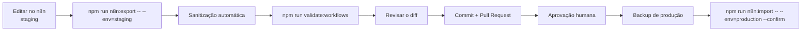

# 06 — n8n

## 1. Papel

O n8n é o **único motor de automação** do sistema comercial. Não porque seja preferência,
mas porque o plano atual do HubSpot não tem Workflows (`01-auditoria-inicial.md` §4.3).

Ele orquestra, agenda, recebe webhooks, processa eventos, integra, controla envio, executa
regras, gerencia aprovação humana, gera relatórios e emite alertas.

## 2. Princípio de desenho

**Workflows pequenos, independentes e reutilizáveis.** Um workflow gigante é impossível de
testar, de reverter e de entender seis meses depois.

Cada workflow declara: finalidade, gatilho, entrada, saída, tratamento de erro,
idempotência, logs, limite de execução, timeout, tentativas, fallback, alerta e
documentação. Sem esses itens, não entra no repositório.

## 3. Os 20 workflows

| Código | Nome | Gatilho | Fase |
|---|---|---|---|
| COM-01 | Ingestão de Eventos | Webhook (SaaS) | 1 |
| COM-02 | Sincronização HubSpot | Sub-workflow | 1 |
| COM-03 | WhatsApp Inbound | Webhook (Meta) | 2 |
| COM-04 | WhatsApp Outbound | Sub-workflow | 2 |
| COM-05 | Qualificação de Lead | Sub-workflow | 2 |
| COM-06 | Onboarding e Trial | Evento + agenda | 3 |
| COM-07 | Ativação de Usuário | Evento | 3 |
| COM-08 | Conversão de Trial | Agenda | 4 |
| COM-09 | Checkout Abandonado | Evento + espera | 4 |
| COM-10 | Pagamento Falhou | Evento | 4 |
| COM-11 | Retenção | Agenda | 5 |
| COM-12 | Cancelamento | Evento | 5 |
| COM-13 | Reativação | Agenda | 5 |
| COM-14 | Relatório Diário | Cron | 6 |
| COM-15 | Relatório Semanal | Cron | 6 |
| COM-16 | Aprovação Humana | Sub-workflow | 1 |
| COM-17 | Tratamento de Erros | Error Workflow global | 1 |
| COM-18 | Controle de Consentimento | Sub-workflow | 1 |
| COM-19 | Base de Conhecimento | Sub-workflow | 2 |
| COM-20 | Monitoramento de Custos | Cron + sub-workflow | 1 |

Documentação individual em `automation/n8n/documentation/COM-NN-*.md`.

### Fundação primeiro

COM-01, COM-02, COM-16, COM-17, COM-18 e COM-20 são a fundação. **Nenhum workflow de
mensagem sobe antes deles.** Sem consentimento (18), sem controle de custo (20), sem
tratamento de erro (17) e sem aprovação humana (16), um workflow de envio é um risco.

## 4. Padrões obrigatórios

### 4.1 Entrada
Todo webhook valida assinatura HMAC antes de qualquer processamento. Todo sub-workflow
valida o formato da entrada e falha explicitamente.

### 4.2 Idempotência
Todo workflow disparado por evento verifica `event_id` antes de agir. Já processado →
encerra com `{duplicate:true}`.

### 4.3 Guardas antes de todo envio
Ordem fixa, sem exceção:

```
1. COMMERCIAL_AI_KILL_SWITCH está ativo?      → para
2. Contato tem consentimento para o canal?     → para ou troca de canal
3. Contato deu opt-out?                        → para definitivamente
4. Limite de frequência foi atingido?          → reagenda
5. Está no horário permitido?                  → reagenda
6. Já foi enviada mensagem equivalente?        → suprime
7. Teto de custo do dia foi atingido?          → só o que é gratuito
8. A ação exige aprovação humana?              → COM-16
```

Implementadas como sub-workflow único (COM-18) chamado por todos os workflows de envio. Uma
guarda duplicada é uma guarda que vai divergir.

### 4.4 Erro
Error Workflow global apontando para COM-17. Nenhum workflow falha em silêncio. Ele
classifica (temporário × permanente), decide retentativa, encaminha para fila de falhas e
alerta quando o limite é ultrapassado.

### 4.5 Timeout e retentativa
Timeout padrão de 30s por chamada externa. Máximo de 3 tentativas com recuo exponencial.
Depois: fila de falhas, nunca descarte silencioso.

### 4.6 Logs
Sempre com dados pessoais mascarados. Nunca conteúdo íntegro de mensagem em log. Ver
`09-seguranca.md`.

## 5. Nomes

Arquivo e workflow: `COM-NN-Nome-Em-Kebab`. Sub-workflow: mesmo padrão com sufixo `-Sub`.
Nó: verbo no infinitivo (`Validar assinatura`, `Buscar contato`, `Enviar mensagem`).

## 6. Versionamento

O GitHub versiona; o n8n executa. Fluxo obrigatório:



### Sanitização — o que é removido antes do commit

Credenciais e ids de credencial, tokens e chaves em qualquer campo, headers de autorização,
URLs de webhook com segredo no caminho, dados de execução (`pinData`, amostras),
qualquer telefone, e-mail, CPF ou CNPJ que tenha sobrado em nó de teste.

`npm run validate:workflows` **falha** se qualquer um desses padrões sobreviver. Workflow
que não passa não entra no repositório.

### Importação
`npm run n8n:import` exige `--confirm`. Com `--env=production` exige **também** confirmação
de que existe backup e aprovação registrada. Nunca sobrescreve produção sem: backup,
validação, teste em staging, aprovação e plano de reversão.

## 7. Ambientes

| Ambiente | Uso | Dados |
|---|---|---|
| development | Construção | Sintéticos |
| staging | Homologação e teste de integração | Sintéticos |
| production | Operação | Reais — só após aprovação |

Credenciais separadas por ambiente. Nunca a mesma credencial em dois ambientes.

## 8. Human-in-the-loop (COM-16)

Ação que exige aprovação gera solicitação com: o que se pretende fazer, para quem, por quê,
qual regra disparou, custo estimado e o que acontece se ninguém responder.

Sem resposta dentro do prazo → **ação não executada**. O silêncio nunca aprova.

## 9. Levantamento pendente

> **Bloqueio B-01.** Não houve acesso à instância nesta sessão. Confirmar com o proprietário:

| # | Pergunta | Por quê |
|---|---|---|
| 1 | Cloud ou self-hosted? Versão? | Define recursos disponíveis |
| 2 | Limite de execuções do plano | Dimensiona a granularidade |
| 3 | **Retenção de execuções** | **LGPD** — execuções guardam telefone e mensagem |
| 4 | Credenciais já configuradas | Evita recriar |
| 5 | Workflows existentes | Evita duplicar |
| 6 | Nós de IA disponíveis | Define onde fica o roteamento de modelo |
| 7 | Suporte a `Wait`/aprovação | Necessário para COM-16 |
| 8 | Error Workflow global configurado | Necessário para COM-17 |
| 9 | Controle de fila / concorrência | Dimensiona picos |
| 10 | Política de backup | Obrigatório antes de importar |

Como obter: `Configurações → Uso` (plano e execuções), `Configurações → Retenção de dados`,
`Credenciais` (listar sem revelar valores), `Workflows` (listar), `Ajuda → Sobre` (versão).

O item 3 é o mais urgente: se a retenção for longa, cada execução do WhatsApp guarda
conteúdo de conversa por meses. **Recomendação: 7 dias para execuções bem-sucedidas, 30 dias
para falhas.**

## 10. Custos

O n8n já está pago. O sistema não exige upgrade se os workflows forem enxutos: sem
polling desnecessário, agendamentos agrupados, processamento em lote nos relatórios e
sub-workflows reutilizados em vez de lógica repetida.

COM-20 monitora execuções e alerta se o consumo se aproximar do limite do plano.
