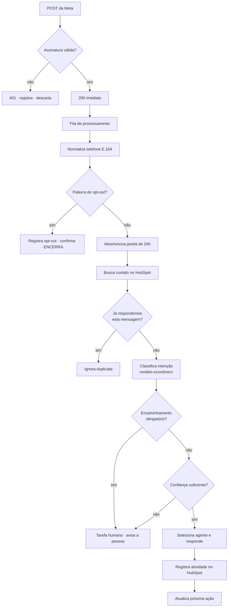

# 07 — WhatsApp

> Pesquisa da documentação oficial da Meta realizada em **24/07/2026**. As regras da
> plataforma mudam; revalidar antes de cada fase que envolva envio.

## 1. Decisão

**WhatsApp Business Cloud API oficial da Meta, conectada diretamente ao n8n.**

Sem ManyChat, WATI, Zenvia, Take Blip, Twilio, Gupshup, respond.io ou ChatGuru. Todos são
intermediários que cobram mensalidade sobre uma API que já é acessível de graça (paga-se
apenas a mensagem, à Meta). Ver `ADR-004`.

⛔ **Proibido em produção:** bibliotecas que imitam o WhatsApp Web, sessão por QR Code,
automação de navegador. Violam os Termos, derrubam o número e não têm suporte. Aceitáveis
apenas como protótipo descartável, com risco documentado — nunca como arquitetura.

## 2. Modelo de cobrança vigente

| Regra | Situação em 24/07/2026 |
|---|---|
| Unidade de cobrança | **Por mensagem** — o modelo por conversa de 24h está **descontinuado** |
| O que define a tarifa | Categoria do template + país + faixa de volume |
| Categorias | `marketing` · `utility` · `authentication` · `service` |
| Mensagens de **serviço** | **Gratuitas** |
| Templates `utility` **dentro da janela** | **Gratuitos** desde 01/07/2025 |
| Faixas de volume | Tarifa cai conforme o volume sobe |
| Última rodada de reajuste | 01/07/2026 (Brasil não consta entre os países alterados) |

> **Rate card do Brasil não confirmado.** A página de preços da Meta recusou acesso
> automatizado (HTTP 403). `config/costs/whatsapp-costs.json` nasce com valores `null` e
> `status: "nao_confirmado"`. Preencher com os números do painel da Meta antes de qualquer
> envio pago. Nenhum valor de custo aparece embutido em código.

## 3. Janela de atendimento

- Mensagem (ou ligação) **do usuário** abre — ou renova — uma janela de **24 horas**.
- **Janela aberta:** qualquer tipo de mensagem, texto livre inclusive.
- **Janela fechada:** somente template aprovado.

### É aqui que o custo é decidido

| Situação | Custo |
|---|---|
| Usuário escreve → respondemos em texto livre | **Zero** |
| Usuário escreve → enviamos template `utility` na janela | **Zero** |
| Janela fechada → template `utility` | Pago |
| Janela fechada → template `marketing` | Pago (mais caro) |

Três regras de arquitetura decorrem disso:

1. **Fazer o usuário escrever primeiro.** Botão "Falar no WhatsApp" no app, no e-mail e no
   site — sempre com mensagem pré-preenchida. Cada conversa iniciada pelo usuário é 24h de
   comunicação gratuita.
2. **Comunicação operacional é `utility`, nunca `marketing`.** Fim de trial, falha de
   pagamento, onboarding e confirmação são `utility`. Usar `marketing` para isso é pagar
   mais caro pela mesma frase — e arriscar a categorização.
3. **Adiar o que pode esperar.** Se o contato tende a escrever nas próximas horas, esperar
   sai de graça.

## 4. Consentimento

Só é permitido enviar para quem deu **opt-in**. Registramos, por contato:

- `mnf_consent_whatsapp` (bool)
- `mnf_consent_whatsapp_data` (quando)
- `mnf_consent_whatsapp_origem` (onde e com que texto)

**Opt-out é imediato e definitivo.** Reconhecer no mínimo: `sair`, `parar`, `pare`,
`cancelar`, `descadastrar`, `remover`, `stop`, `não quero`, `nao quero`, `me tira`. A
palavra é processada **antes** de qualquer chamada de IA — é regra, não interpretação.

Após o opt-out: confirmação única e nenhuma mensagem automatizada depois. O registro do
opt-out nunca é apagado.

## 5. Limites e qualidade

| Item | Regra |
|---|---|
| Limite inicial | **250 destinatários únicos / 24h** fora da janela, para número novo |
| Escalonamento | Sobe para 1.000 e além pelos caminhos oficiais da Meta |
| Qualidade | Últimos 7 dias, ponderada por recência |
| Sinais negativos | Bloqueio, denúncia, silenciamento, arquivamento |
| Consequência | Qualidade baixa derruba o limite; reincidência bane o número |
| Número banido | Só volta por recurso formal |

**250/24h descarta disparo em massa desde o primeiro dia** — por limite técnico, antes
mesmo da política. O sistema é de conversa, não de campanha.

### Proteção da qualidade

`config/commercial-rules/contact-frequency.json` impõe:

- máximo de mensagens iniciadas pelo negócio por contato por semana;
- intervalo mínimo entre mensagens;
- limite de tentativas sem resposta;
- **parada imediata** após resposta, conversão, cancelamento ou opt-out;
- horário permitido (nada de madrugada);
- teto diário global de mensagens iniciadas pelo negócio.

## 6. Segurança do webhook

### Verificação (GET)
A Meta chama com `hub.mode`, `hub.verify_token`, `hub.challenge`. Comparar o token com
`WHATSAPP_VERIFY_TOKEN` e devolver o `hub.challenge` **em texto puro**.

### Recebimento (POST)
```
X-Hub-Signature-256: sha256=<hex>
assinatura = HMAC_SHA256(WHATSAPP_APP_SECRET, corpo_bruto)
```

Validar sobre o **corpo bruto**, antes do parsing, com comparação em tempo constante.
Assinatura inválida = `401`, sem processar e sem reprocessar.

A Meta reenvia em caso de falha: **responder `200` rápido** e processar em segundo plano.
Processamento síncrono demorado gera reentrega e resposta duplicada.

## 7. Fluxo de entrada



## 8. Intenções mínimas

`conhecer_produto` · `saber_preco` · `iniciar_teste` · `emitir_nota_fiscal` ·
`criar_recibo` · `criar_orcamento` · `analisar_contrato` · `suporte_tecnico` ·
`pagamento` · `cancelamento` · `reclamacao` · `falar_com_humano` · `nao_relacionado`

Classificador econômico com limiar de confiança. Abaixo do limiar → humano. Nunca chute.

## 9. Encaminhamento humano

`cancelamento`, `reclamacao` e `falar_com_humano` vão direto para pessoa. Também: ameaça
judicial, pedido de reembolso, suspeita de vazamento, acusação de fraude, erro fiscal,
pergunta jurídica individual, conflito contratual, pessoa alterada, falha reiterada, baixa
confiança e ausência de informação confirmada. Lista completa em `03-agentes.md` §6.

## 10. Templates

Todo template é versionado em `prompts/templates/whatsapp/` com: nome, categoria, idioma,
corpo com variáveis, quando usar, quando **não** usar e status de aprovação na Meta.

Regras: nunca `marketing` para operacional; nunca dado sensível em variável; sempre uma
mensagem que resolve em vez de três fragmentadas; sempre saída clara para atendimento
humano.

## 11. Pendências antes da Fase 2

| Item | Responsável |
|---|---|
| Número comercial dedicado | Proprietário |
| WhatsApp Business Account + verificação do negócio | Proprietário |
| Definir se o número já está no app WhatsApp Business (exige migração) | Proprietário |
| Copiar o rate card do Brasil para `whatsapp-costs.json` | Proprietário |
| Cadastrar e aprovar os templates iniciais | Conjunto |
| Coletar telefone + opt-in no cadastro do SaaS | Fase 1 |

> Migrar um número já em uso no app WhatsApp Business para a Cloud API **encerra o uso pelo
> aplicativo**. Verificar as regras de coexistência vigentes na Meta antes de migrar um
> número em operação.

## Fontes

- [Pricing on the WhatsApp Business Platform](https://developers.facebook.com/documentation/business-messaging/whatsapp/pricing)
- [Pricing Updates](https://developers.facebook.com/docs/whatsapp/pricing/updates-to-pricing/)
- [Template categorization](https://developers.facebook.com/documentation/business-messaging/whatsapp/templates/template-categorization)
- [Messaging limits](https://developers.facebook.com/docs/whatsapp/messaging-limits/)
- [Get opt-in for WhatsApp](https://developers.facebook.com/documentation/business-messaging/whatsapp/getting-opt-in)
- [Send messages / service messages](https://developers.facebook.com/documentation/business-messaging/whatsapp/messages/send-messages)
- [Business phone numbers](https://developers.facebook.com/documentation/business-messaging/whatsapp/business-phone-numbers/phone-numbers)
