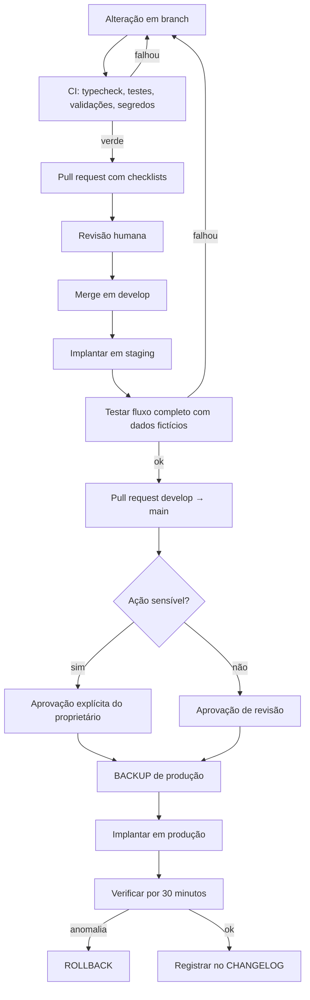

# 12 — Deploy

## 1. O que existe para implantar

Este sistema não é uma aplicação com build. O que vai para produção é:

| Artefato | Onde executa | Como vai |
|---|---|---|
| Workflows do n8n | n8n | `scripts/import-n8n/` com aprovação |
| Prompts | Lidos pelos workflows | Junto com o workflow |
| Políticas (`config/`) | Lidas pelos workflows | Junto com o workflow |
| Propriedades e pipeline do HubSpot | HubSpot | `scripts/migrate-hubspot/` com aprovação |
| Templates de WhatsApp | Meta | Aprovação manual na Meta |
| Emissor de eventos | SaaS `mei-facil` | Deploy do SaaS (outro repositório) |

## 2. Ambientes

| Ambiente | n8n | HubSpot | WhatsApp | Dados |
|---|---|---|---|---|
| development | Instância/projeto de dev | — | — | Sintéticos |
| staging | Instância/projeto de staging | Sandbox ou contatos de teste | Número de teste | Sintéticos |
| production | Instância de produção | Portal 51640620 | Número comercial | Reais |

**Credenciais separadas por ambiente.** Um erro em staging jamais pode alcançar cliente real.

## 3. Fluxo de implantação

## 4. Ações que exigem aprovação explícita do proprietário

- Alterar preço ou criar plano
- Alterar política de desconto ou extensão de trial
- Publicar campanha paga ou aumentar orçamento
- Enviar comunicação em massa
- Alterar texto de mensagem comercial em produção
- Alterar regras de aprovação humana ou de autonomia
- Alterar limites de custo
- Alterar propriedade ou pipeline do HubSpot em produção
- Importar workflow em produção
- Qualquer coisa que gere custo novo

O CI **não** implanta em produção automaticamente. Nunca.

## 5. Backup antes de qualquer implantação

| Artefato | Como |
|---|---|
| Workflows do n8n | `npm run n8n:export -- --env=production` antes de importar |
| Configuração do HubSpot | Exportar propriedades e pipeline |
| Estado atual | Registrar o commit em produção |

`npm run n8n:import -- --env=production` **recusa executar** sem confirmação de backup.

## 6. Rollback

| Situação | Ação | Tempo |
|---|---|---|
| Mensagem errada saindo | **`COMMERCIAL_AI_KILL_SWITCH=true`** | Imediato |
| Workflow com defeito | Reimportar a versão anterior do repositório | Minutos |
| Prompt ruim | Reverter o commit e reimportar | Minutos |
| Política errada | Reverter o arquivo em `config/` | Minutos |
| Propriedade do HubSpot | Restaurar do backup | Minutos |
| Dados já alterados no CRM | ⚠️ Nem sempre reversível | Variável |

**Primeiro se para, depois se conserta.** O kill switch existe para ser usado antes do
diagnóstico, não depois.

### O que não se reverte

Mensagem enviada, cobrança feita, dado eliminado. Por isso essas ações exigem aprovação
humana antes, não plano de rollback depois.

## 7. Verificação pós-implantação

Nos 30 minutos seguintes:

- [ ] Eventos chegando e sendo processados
- [ ] Nenhuma execução em erro no n8n
- [ ] Contatos sendo atualizados no HubSpot
- [ ] Nenhuma mensagem duplicada
- [ ] Custo dentro do esperado
- [ ] Consentimentos sendo respeitados
- [ ] Alertas silenciosos

Qualquer item falhando → rollback, sem discussão.

## 8. Primeira implantação (Fase 1)

Ordem obrigatória:

1. Corrigir fuso e moeda do HubSpot.
2. Criar propriedades e pipeline (staging primeiro).
3. Criar o Private App e guardar o token no n8n.
4. Importar COM-17 (erros) e COM-18 (consentimento) — **a fundação vem antes**.
5. Importar COM-20 (custos) e COM-16 (aprovação).
6. Importar COM-01 (ingestão) e COM-02 (HubSpot).
7. Implantar o emissor de eventos no SaaS **em modo sombra**: envia e registra, sem
   disparar nenhuma ação comercial.
8. Observar por 48 horas.
9. Só então ligar as ações.

O modo sombra é o que permite descobrir que um evento vem errado **antes** de ele virar
mensagem para um cliente.

## 9. Checklist de implantação

- [ ] CI verde
- [ ] Testado em staging com dados fictícios
- [ ] Backup de produção feito e verificado
- [ ] Aprovação humana registrada (se sensível)
- [ ] Plano de rollback escrito no pull request
- [ ] Variáveis novas configuradas no ambiente
- [ ] Kill switch acessível e testado
- [ ] CHANGELOG atualizado
- [ ] Quem verifica nos 30 minutos seguintes está definido
