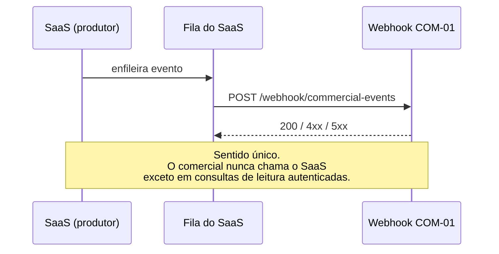

# Contrato de Integração — `mei-facil` ↔ Sistema Comercial

| Campo | Valor |
|---|---|
| Versão | 1.0 |
| Data | 24/07/2026 |
| Produtor | `fabriciopazadv/mei-facil` |
| Consumidor | `fabriciopazadv/mei-nota-facil-commercial-ai` (via n8n) |
| Status | **Proposto** — a implementar na Fase 1 |

Documento **normativo**: os dois lados se comprometem com o que está aqui. Alteração exige
pull request nos dois repositórios.

## 1. Princípios

1. Comunicação apenas por **HTTP com evento assinado**.
2. O sistema comercial **não acessa o banco do SaaS** — nem leitura.
3. O SaaS não conhece HubSpot, WhatsApp nem n8n. Só publica eventos.
4. Eventos carregam **sinal**, não conteúdo de documento.
5. O SaaS não espera resposta comercial: publica e segue.

## 2. Sentido do fluxo



Consulta de volta (`SAAS_API_BASE_URL`) é opcional, somente leitura, autenticada, restrita a
dados comerciais mínimos (status de assinatura, dia do trial) e **nunca** a documento
fiscal ou dado de cliente do MEI.

## 3. Endpoint

```
POST {N8N_BASE_URL}/webhook/commercial-events
Content-Type: application/json
X-Event-Signature: sha256=<hex>
X-Event-Timestamp: <epoch segundos>
```

## 4. Envelope

```json
{
  "event_id": "550e8400-e29b-41d4-a716-446655440000",
  "event_name": "trial_started",
  "event_version": 1,
  "occurred_at": "2026-07-24T18:30:00.000Z",
  "user_id": "clx1a2b3c4d5e6f7g8h9",
  "tenant_id": "clx0z9y8x7w6v5u4t3s2",
  "contact_id": null,
  "email": "teste@example.com",
  "phone": "+5511900000000",
  "source": "organico",
  "campaign": null,
  "plan": "MENSAL",
  "trial_day": 0,
  "metadata": {}
}
```

Regras completas em [`04-eventos.md`](04-eventos.md) §2. Schema JSON em
`automation/n8n/schemas/event-envelope.schema.json`. Schema Zod em `src/events/schema.ts`.

### Proibido no payload

Nome, CPF/CNPJ, telefone ou e-mail de **cliente do MEI**; conteúdo de NFS-e, recibo,
orçamento ou contrato; valores faturados pelo MEI; dados de certificado; senha ou token.

**Violação disso é incidente de dados pessoais**, não defeito de formatação. Ver
`lgpd-mapa-de-dados.md` §3.

## 5. Autenticação

```
assinatura = HMAC_SHA256(WEBHOOK_SIGNING_SECRET, timestamp + "." + corpo_bruto)
header     = "sha256=" + hex(assinatura)
```

Requisitos: comparação em tempo constante; validação sobre o corpo **bruto**, antes do
parsing; timestamp fora de ±300s rejeitado; segredo com no mínimo 32 bytes aleatórios.

Na rotação, o consumidor aceita o segredo antigo e o novo por 24 horas.

## 6. Respostas e retentativa

| Código | Corpo | Produtor reenvia? |
|---|---|---|
| `200` | `{"accepted":true}` ou `{"duplicate":true}` | Não |
| `400` | `{"error":"invalid_schema","details":[...]}` | **Não** — defeito |
| `401` | `{"error":"invalid_signature"}` | **Não** |
| `422` | `{"error":"unknown_event"}` | **Não** |
| `429` | `{"error":"rate_limited","retry_after":N}` | Sim, após `retry_after` |
| `5xx` | `{"error":"internal"}` | Sim, com recuo |

**Backoff:** 1s, 2s, 4s, 8s, 16s, 32s, 64s (7 tentativas). Depois, fila de falhas com
alerta. Nenhum evento se perde em silêncio.

**Timeout do produtor:** 10s. Estouro conta como falha temporária.

## 7. Idempotência

`event_id` é a chave, gerado na origem (UUID v4), **estável entre retentativas** — reenviar
com id novo cria duplicata.

Janela de deduplicação do consumidor: **7 dias**. Duplicado responde `200 {"duplicate":true}`.

## 8. Versionamento

| Mudança | Incrementa `event_version`? |
|---|---|
| Campo novo **opcional** | Não |
| Valor novo em enum | Não |
| Evento novo | Não (é evento novo) |
| Campo removido ou renomeado | **Sim** |
| Tipo alterado | **Sim** |
| Campo opcional vira obrigatório | **Sim** |
| Semântica alterada | **Sim** |

Compatibilidade: o consumidor aceita a versão atual e a anterior por, no mínimo, **30 dias**.
Versão desconhecida → `422`, registrada e alertada.

## 9. Descontinuação

1. Marcar como `deprecated` neste documento, com a data.
2. Avisar com **60 dias** de antecedência.
3. Manter funcionando durante o período.
4. Verificar que ninguém mais consome.
5. Remover, registrando no CHANGELOG dos dois repositórios.

**Nunca remover sem aviso**, mesmo que pareça que ninguém usa.

## 10. Consulta de volta (opcional)

```
GET {SAAS_API_BASE_URL}/api/commercial/subscription-status?user_id=...
Authorization: Bearer {SAAS_API_TOKEN}
```

```json
{ "user_id": "clx...", "status": "TRIAL", "plan": "MENSAL",
  "trial_started_at": "...", "trial_ends_at": "...", "trial_day": 7,
  "activation_signals": { "budget": true, "receipt": true, "nfse": false } }
```

Somente leitura. Somente dados comerciais. Limite de taxa aplicado. **Nunca** documento
fiscal nem dado de cliente do MEI.

## 11. Responsabilidades

| Responsabilidade | Produtor (SaaS) | Consumidor |
|---|---|---|
| Gerar `event_id` único e estável | ✅ | |
| Assinar a requisição | ✅ | |
| Enfileirar e reenviar | ✅ | |
| Normalizar telefone em E.164 | ✅ | Revalida |
| Não vazar dado proibido | ✅ | Rejeita se detectar |
| Validar assinatura | | ✅ |
| Deduplicar | | ✅ |
| Validar schema | | ✅ |
| Responder rápido (< 2s) | | ✅ |
| Alertar em falha | ✅ | ✅ |

## 12. Testes de contrato

Fixtures compartilhadas em `tests/fixtures/events/`, com dados **fictícios**. Ambos os lados
testam contra as mesmas fixtures.

Casos obrigatórios: evento válido aceito; assinatura inválida → `401`; timestamp expirado →
`401`; `event_id` repetido → `duplicate`; schema inválido → `400`; evento desconhecido →
`422`; telefone em formato local → rejeitado; campo proibido no `metadata` → rejeitado.

## 13. Registro de mudanças

| Versão | Data | Mudança |
|---|---|---|
| 1.0 | 24/07/2026 | Contrato inicial |
