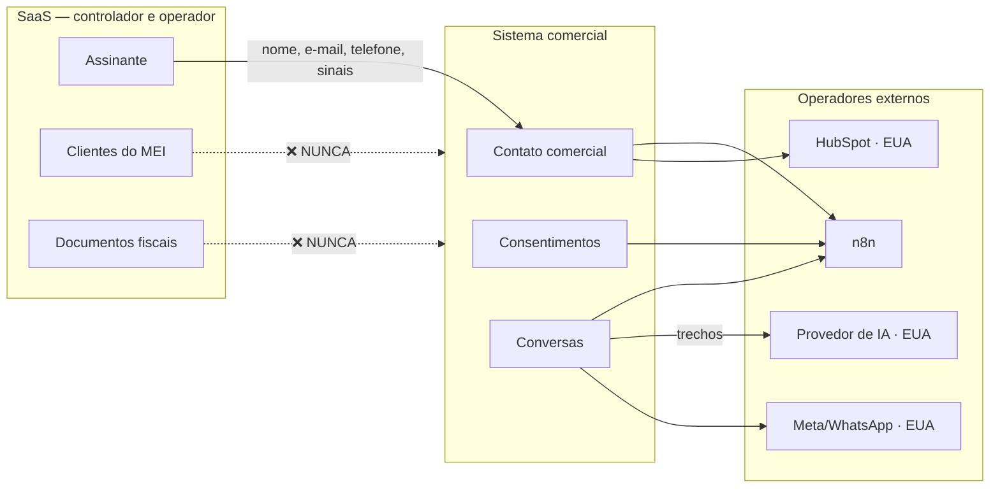

# LGPD — Mapa de Dados

> ⚖️ Não é parecer jurídico. Ver `10-lgpd.md`.

| Versão | Data | Responsável |
|---|---|---|
| 1.0 | 24/07/2026 | Agente construtor, sob revisão humana |

## 1. Titulares

| Nível | Quem | Nosso papel | Tratado pelo sistema comercial |
|---|---|---|---|
| 1 | Assinante (o MEI) | **Controlador** | ✅ Sim |
| 2 | Clientes do assinante | **Operador** | ❌ **Nunca** |
| 3 | Visitante / lead | **Controlador** | ✅ Sim |

## 2. Dados tratados

| Dado | Origem | Finalidade | Base legal ⚖️ | Retenção | Compartilhado com |
|---|---|---|---|---|---|
| Nome | Cadastro / lead | Identificação e tratamento pessoal | Execução de contrato / legítimo interesse | Enquanto ativo + 5 anos | HubSpot |
| E-mail | Cadastro / lead | Comunicação | Execução de contrato | Enquanto ativo + 5 anos | HubSpot, provedor de e-mail |
| Telefone | Cadastro / WhatsApp | Atendimento | **Consentimento** (WhatsApp) | Até revogação | HubSpot, Meta |
| Cidade / Estado | Cadastro | Segmentação e adequação fiscal | Legítimo interesse | Enquanto ativo | HubSpot |
| Atividade profissional | Conversa | Adequar comunicação | Legítimo interesse | Enquanto ativo | HubSpot |
| Origem do lead / campanha | UTM, referrer | Medir eficiência de canal | Legítimo interesse | 2 anos | HubSpot |
| Estágio no funil | Sistema | Conduzir o processo comercial | Legítimo interesse | Enquanto ativo | HubSpot |
| Scores (intenção, ativação, risco) | Cálculo | Priorizar atendimento | Legítimo interesse | Enquanto ativo | HubSpot |
| Sinais de uso (booleanos) | Eventos | Medir ativação | Legítimo interesse | 2 anos | HubSpot |
| Consentimentos | Cadastro / conversa | Prova de conformidade | **Obrigação legal** | **Permanente** | HubSpot |
| Opt-out | Conversa | Prova de respeito ao pedido | **Obrigação legal** | **Permanente** | HubSpot |
| Conversas comerciais | WhatsApp / e-mail | Atendimento e continuidade | Execução de contrato / legítimo interesse | 12 meses | Meta, n8n, IA |
| Status da assinatura | SaaS | Conduzir cobrança e retenção | Execução de contrato | Enquanto ativo + 5 anos | HubSpot |
| Motivo de cancelamento | Conversa | Melhorar o produto | Legítimo interesse | 2 anos | HubSpot |

## 3. Dados que o sistema comercial **NÃO** trata

Proibição de arquitetura, não de política. Verificada por teste automatizado.

| Dado | Onde vive | Por que não vem |
|---|---|---|
| **Clientes do MEI** (nome, CPF/CNPJ, contato) | `Customer` no SaaS | Somos **operador**; usar para venda própria é finalidade incompatível |
| CPF / CNPJ do assinante | `MeiProfile.cnpj` | Sem finalidade comercial |
| Conteúdo de NFS-e, recibo, orçamento | `NfseDocument`, `Quote` | Sem finalidade comercial |
| Texto de contrato analisado | `ContractOrientationReport` | Altamente sensível |
| Certificado digital e senha | Ambiente do SaaS | Credencial fiscal |
| Senha / hash | `User.passwordHash` | Nunca sai |
| Dados bancários / cartão | Asaas | Nunca tocamos |
| Valores faturados pelo MEI | `Payment` | Sigilo do negócio dele |

Os eventos carregam **sinal**, não conteúdo:

```json
{ "event_name": "first_receipt_created", "user_id": "clx...", "metadata": { "valor": "PROIBIDO" } }
```

O campo `valor` acima **não** existe. O sistema comercial sabe que um recibo foi criado;
não sabe de quanto nem para quem.

## 4. Fluxo dos dados



## 5. Operadores

| Operador | Dados | País | Ponto de atenção |
|---|---|---|---|
| HubSpot | Contato comercial completo | EUA | ⚖️ Transferência internacional |
| Meta (WhatsApp) | Telefone, conteúdo das mensagens | EUA | ⚖️ Idem |
| Provedor de IA | Trechos de conversa | EUA | ⚖️ Idem + política de treinamento |
| n8n | Todos, em trânsito | Conforme hospedagem | Retenção de execuções (B-01) |
| Provedor de e-mail | Nome e e-mail | A definir | ⚖️ A avaliar na escolha |
| Asaas | Dados de pagamento | Brasil | Não acessado por este sistema |
| Vercel | Logs da aplicação | EUA | Risco R-07 (payload em log) |

## 6. Pontos de coleta

| Ponto | Dados | Consentimento | Status |
|---|---|---|---|
| Cadastro no SaaS | Nome, e-mail, senha | Aceite dos Termos | ✅ Existe |
| Telefone + opt-in de WhatsApp | Telefone | **Explícito** | ❌ **A criar — Fase 1** |
| Origem do lead (UTM) | Campanha, referrer | Aviso de cookies ⚖️ | ❌ A criar |
| Primeira mensagem de WhatsApp | Telefone | Opt-in implícito pelo início da conversa ⚖️ | ❌ A criar |
| Formulário do HubSpot | Nome, e-mail, telefone | Explícito | ❌ A criar |

## 7. Pendências

1. ⚖️ Validação jurídica de todas as bases legais.
2. Implementar coleta de telefone com opt-in explícito (Fase 1).
3. Confirmar retenção do n8n (B-01).
4. Verificar a política de uso de dados do provedor de IA escolhido.
5. Adequar a Política de Privacidade ao tratamento comercial.
6. Definir encarregado (DPO) e canal do titular.
