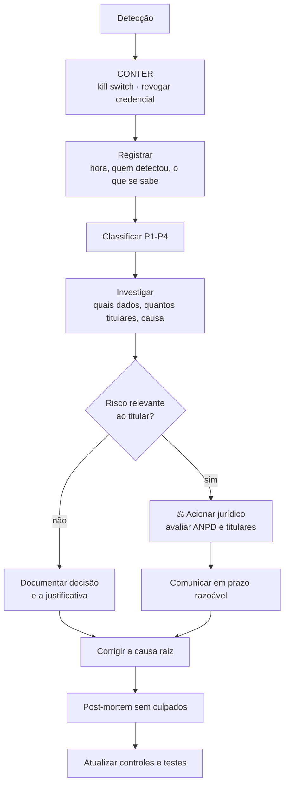

# LGPD — Resposta a Incidentes de Dados Pessoais

> ⚖️ Procedimento técnico preparatório. A comunicação à ANPD e aos titulares deve ser
> conduzida com apoio jurídico. Ver `10-lgpd.md`.

| Versão | Data | Status |
|---|---|---|
| 1.0 | 24/07/2026 | Aguardando validação jurídica |

Aspectos técnicos e operacionais gerais em [`14-incidentes.md`](14-incidentes.md).

## 1. O que é incidente de dados pessoais

Qualquer evento que comprometa confidencialidade, integridade ou disponibilidade de dado
pessoal. Exemplos concretos neste sistema:

- Credencial do HubSpot, da Meta ou do n8n vazada
- Mensagem enviada ao contato errado
- Log com dado pessoal exposto indevidamente
- Acesso não autorizado ao n8n ou ao repositório
- Exportação de contatos fora de procedimento
- Envio a quem deu opt-out
- Dado de cliente do MEI trafegando para o sistema comercial (violação da regra do
  `lgpd-mapa-de-dados.md` §3)
- IA revelando dado de um contato a outro

## 2. Classificação

| Nível | Critério | Exemplo |
|---|---|---|
| **P1 — Crítico** | Muitos titulares ou dado sensível, ou vazamento externo confirmado | Token do HubSpot exposto publicamente |
| **P2 — Alto** | Poucos titulares, dado comum, exposição limitada | Mensagem enviada ao contato errado |
| **P3 — Médio** | Exposição interna, sem acesso indevido confirmado | Log com e-mail não mascarado |
| **P4 — Baixo** | Risco potencial sem exposição | Configuração incorreta detectada e corrigida |

## 3. Fluxo

## 4. Contenção — primeiros 30 minutos

Ordem, sem deliberação:

1. **`COMMERCIAL_AI_KILL_SWITCH=true`** — para todo envio.
2. **Revogar a credencial suspeita** — revogar primeiro, investigar depois.
3. **Não apagar log nem histórico** — é prova; apagar piora tudo.
4. **Registrar o horário exato** da detecção.
5. **Avisar o proprietário.**

Se houver dúvida sobre o alcance, tratar como maior até prova em contrário.

## 5. Investigação

Responder por escrito:

| Pergunta | Por quê |
|---|---|
| Quais dados foram afetados? | Define a gravidade |
| Quantos titulares? | Define a comunicação |
| Quando começou e quando terminou? | Define a janela |
| Como aconteceu? | Define a correção |
| Alguém não autorizado acessou de fato? | Diferencia exposição de vazamento |
| Havia mitigação (criptografia, mascaramento)? | Reduz o risco ⚖️ |
| Existe risco relevante ao titular? | Define comunicação à ANPD ⚖️ |

## 6. Comunicação

⚖️ **A decisão de comunicar é jurídica**, com apoio do relatório técnico.

À **ANPD**, quando houver risco ou dano relevante: natureza dos dados, titulares
envolvidos, medidas técnicas de proteção, riscos, motivo de eventual demora e medidas de
reversão. Prazo: razoável, conforme regulamentação vigente ⚖️.

Ao **titular**: linguagem simples, sem jargão, dizendo o que aconteceu, quais dados dele
foram afetados, o que já foi feito, o que ele deve fazer e como falar conosco. Sem
minimizar e sem alarmar.

## 7. Registro

Todo incidente, inclusive P4, entra em registro interno com: identificador, data e hora de
detecção e contenção, classificação, dados e titulares afetados, causa raiz, ações,
decisão sobre comunicação com justificativa, e responsável.

O registro **não** contém os dados vazados — apenas a descrição de quais categorias foram
afetadas.

## 8. Prevenção

| Controle | Previne |
|---|---|
| Mascaramento de log por padrão | Exposição em log |
| Secret scanning + push protection | Credencial no Git |
| Menor privilégio por integração | Alcance de um comprometimento |
| Kill switch | Propagação de envio errado |
| Teste automatizado da regra "cliente do MEI nunca vai ao HubSpot" | Vazamento entre níveis de titular |
| Verificação de opt-out antes de todo envio | Envio a quem pediu para parar |
| Retenção curta | Volume de dado exposto num vazamento |
| Rotação de credencial | Janela de uso de credencial comprometida |

## 9. Simulação

Antes da Fase 2 entrar em produção, executar em staging: (a) vazamento simulado de
credencial e (b) envio simulado ao contato errado. Verificar que o kill switch funciona, que
a revogação é rápida e que existe quem seja acionado.

**Procedimento não testado é procedimento que não existe.**

## 10. Pendências

1. ⚖️ Validação jurídica do fluxo e dos prazos.
2. Definir encarregado (DPO) e canal de contato do titular.
3. Definir quem é acionado fora do horário comercial.
4. Executar a simulação (item 9).
5. Modelo de comunicação ao titular, revisado juridicamente.
